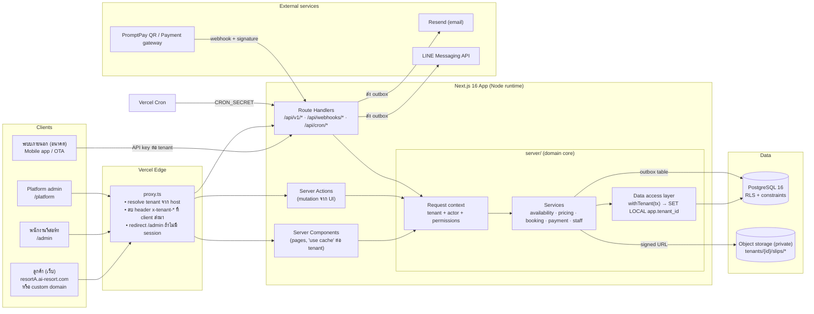
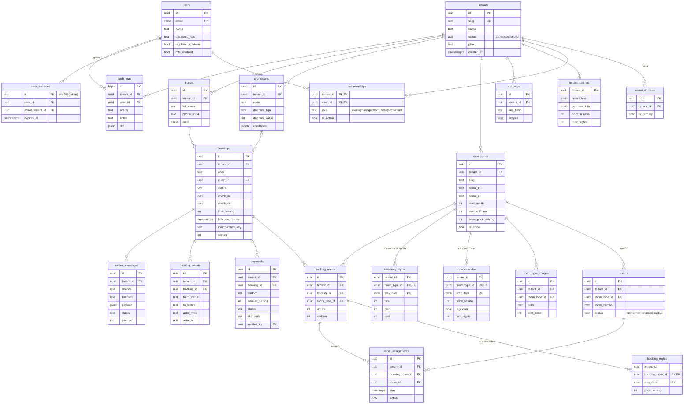
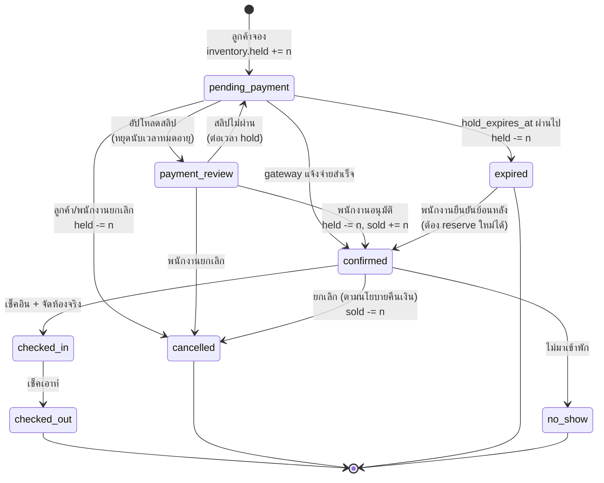
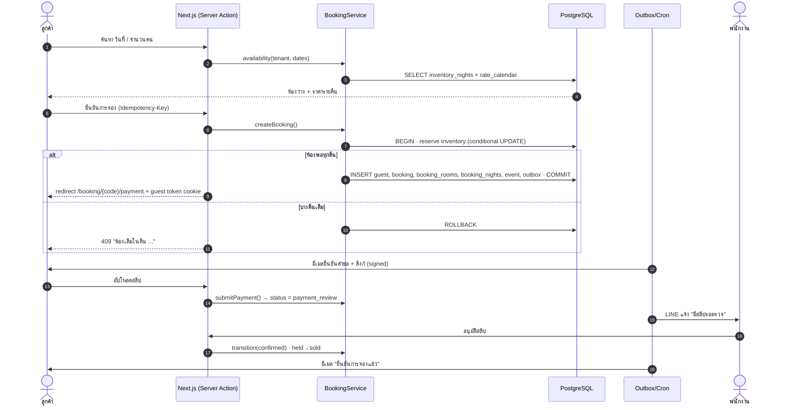

# Phase 0 Report — ระบบจองห้องพัก AI Resort

| | |
|---|---|
| วันที่ | 17 พ.ย. 2569 |
| สถานะ | **ร่าง รออนุมัติ** (ยังไม่เริ่ม Phase 1) |
| ขอบเขตงานใน Phase 0 | อ่านและวิเคราะห์โค้ดเท่านั้น ไม่ได้แก้หรือเขียนทับไฟล์เดิม ไฟล์ที่สร้างใหม่มีไฟล์นี้ไฟล์เดียว |
| ต้นแบบที่ตรวจ | `ai-resort/` (ฟ้าทะเลรีสอร์ท, 15 ห้อง, 3 ประเภท) |

> **สรุปสำหรับผู้อนุมัติ**
> โค้ดปัจจุบันเป็นต้นแบบที่ดี flow การจองครบ และ logic คำนวณห้องว่างถูกต้อง แต่ยังใช้งานจริงไม่ได้ เพราะ (1) เก็บข้อมูลเป็นไฟล์ JSON และกันจองชนด้วยคิวใน memory ซึ่งใช้ไม่ได้เมื่อ deploy (2) ระบบถูกออกแบบสำหรับรีสอร์ทเดียว ข้อมูลรีสอร์ทเขียนตายตัวในโค้ด ไม่มีแนวคิด tenant (3) แอดมินใช้รหัสผ่านร่วมกันรหัสเดียว
> แบบที่เสนอคือ Next.js 16 modular monolith + PostgreSQL ที่ทุกตารางมี `tenant_id` และบังคับแยกข้อมูลด้วย Row-Level Security ส่วนการจองชนป้องกันที่ระดับฐานข้อมูลด้วยตาราง inventory รายคืน (CHECK constraint) และ exclusion constraint
> ก่อนเริ่ม Phase 1 ต้องอนุมัติ **12 เรื่องในหัวข้อ 12**

---

## สารบัญ

1. [Project Structure ปัจจุบัน](#1-project-structure-ปัจจุบัน)
2. [System Architecture Diagram](#2-system-architecture-diagram)
3. [Database ER Diagram](#3-database-er-diagram)
4. [Database Schema เบื้องต้น](#4-database-schema-เบื้องต้น)
5. [Folder Structure ที่เสนอ](#5-folder-structure-ที่เสนอ)
6. [API Architecture](#6-api-architecture)
7. [User Roles & Permissions](#7-user-roles--permissions)
8. [Booking Workflow](#8-booking-workflow)
9. [Double Booking Prevention Design](#9-double-booking-prevention-design)
10. [Multi-Tenant Security Design](#10-multi-tenant-security-design)
11. [Development Roadmap](#11-development-roadmap)
12. [ข้อสงสัยและการตัดสินใจที่ต้องอนุมัติ](#12-ข้อสงสัยและการตัดสินใจที่ต้องอนุมัติ)

---

## 1. Project Structure ปัจจุบัน

### 1.1 Tech stack

| ส่วน | เวอร์ชัน / ค่า |
|---|---|
| Framework | Next.js **16.4.6** (App Router, Turbopack, `cacheComponents: true`, `partialPrefetching: true`) |
| UI | React 19.3, Tailwind CSS 4.3, lucide-react |
| ภาษา | TypeScript 5 |
| ข้อมูล | ไฟล์ `data/bookings.json` (มีการจองทดสอบ 1 รายการ) |
| Auth | รหัสผ่านเดียวจาก `ADMIN_PASSWORD` ใน `.env.local` |
| Version control | **ไม่มี git** |
| Test | ไม่มี |

### 1.2 โครงสร้างไฟล์ (ไม่รวม `node_modules`, `.next`)

```text
ai-resort/
├─ data/bookings.json            # ที่เก็บการจอง (ไฟล์)
├─ public/
│  ├─ images/                    # hero, room-1..3, promo-1..3, fac-*, gal-1..4, about
│  └─ รูป ui/                     # mockup หน้าแรก (PNG 2.3 MB)
├─ src/
│  ├─ app/
│  │  ├─ layout.tsx  globals.css  favicon.ico
│  │  ├─ page.tsx                # หน้าแรก: hero, ค้นหา, ห้องพัก, โปรโมชั่น, สิ่งอำนวยความสะดวก, แกลเลอรี, เกี่ยวกับ, footer
│  │  ├─ rooms-carousel.tsx
│  │  ├─ actions.ts              # Server Actions ทั้งหมด (จอง, ค้นหา, ยกเลิก, login/logout, เปลี่ยนสถานะ)
│  │  ├─ admin/page.tsx          # หลังบ้าน: สรุป + ตารางการจอง + ปุ่มยืนยัน/ยกเลิก
│  │  └─ booking/
│  │     ├─ layout.tsx
│  │     ├─ page.tsx             # ผลค้นหาห้องว่าง
│  │     ├─ details/page.tsx     # กรอกข้อมูลผู้เข้าพัก
│  │     ├─ lookup/page.tsx      # ค้นหาการจองด้วยรหัส + เบอร์
│  │     └─ [code]/page.tsx, not-found.tsx
│  ├─ components/                # booking-forms, logo, site-header, skeleton, stay-search-form, steps
│  └─ lib/
│     ├─ bookings.ts             # storage + availability + create + updateStatus
│     ├─ rooms.ts                # ROOM_TYPES (7+5+3 ห้อง) และ RESORT (hard-code)
│     ├─ search.ts  dates.ts     # ตรวจช่วงวันที่, เวลาไทย
│     └─ admin-auth.ts           # HMAC session cookie
├─ AGENTS.md  README.md  next.config.ts  package.json  tsconfig.json  eslint.config.mjs
└─ .env.local                    # ADMIN_PASSWORD
```

### 1.3 สิ่งที่ทำงานได้แล้ว

- ค้นหาห้องว่าง → เลือกห้อง → กรอกข้อมูล → ได้รหัสการจอง (`FT` + 8 ตัว)
- กันห้อง 24 ชม. ระหว่างรอชำระ หมดเวลาแล้วปล่อยห้องเอง
- ลูกค้าค้นหาและยกเลิกการจองได้ด้วยรหัสการจองและเบอร์โทร
- แอดมินดูรายการ กรองสถานะ ยืนยันหรือยกเลิกได้
- การคำนวณห้องว่างใช้คืนที่มีคนใช้ห้องสูงสุดในช่วงที่ค้นหา ซึ่งถูกต้อง

### 1.4 ปัญหาสถาปัตยกรรมที่พบ และวิธีแก้ที่เสนอ

| # | ระดับ | ปัญหา | ผลกระทบ | วิธีแก้ที่เสนอ |
|---|---|---|---|---|
| A1 | 🔴 วิกฤต | เก็บข้อมูลเป็นไฟล์ JSON (`lib/bookings.ts`) | บน Vercel/serverless เขียนไฟล์ไม่ได้ ข้อมูลหายเมื่อ redeploy | PostgreSQL + Drizzle ORM (หัวข้อ 4) |
| A2 | 🔴 วิกฤต | กันจองชนด้วย `withLock()` ซึ่งเป็น Promise queue ใน memory | ใช้ได้แค่ process เดียว ถ้ารันหลาย instance ห้องสุดท้ายจะถูกจองซ้ำได้ | Inventory รายคืน + CHECK constraint + exclusion constraint ในฐานข้อมูล (หัวข้อ 9) |
| A3 | 🔴 วิกฤต | ไม่มีแนวคิด tenant: `RESORT`, `ROOM_TYPES`, บัญชีธนาคารเป็นค่าคงที่ในโค้ด | รองรับรีสอร์ทที่สองไม่ได้ และแก้ราคาต้อง deploy ใหม่ | ตาราง `tenants` + `tenant_id` ทุกตาราง + RLS (หัวข้อ 10) |
| A4 | 🔴 วิกฤต | แอดมินใช้รหัสผ่านร่วมกัน token = HMAC ของข้อความคงที่ ไม่จำกัดการล็อกอินผิด | เพิกถอน session รายคนไม่ได้ ไม่มีบันทึกว่าใครทำอะไร และเดารหัสผ่านซ้ำได้ไม่จำกัด | บัญชีพนักงานรายคน, argon2id, session ในฐานข้อมูล, rate limit, RBAC (หัวข้อ 7) |
| A5 | 🔴 วิกฤต | ไม่มี git | แก้พลาดแล้วย้อนกลับไม่ได้ | `git init` + commit สถานะปัจจุบันเป็น baseline ก่อน Phase 1 |
| A6 | 🟠 สูง | `/booking/[code]` แสดงชื่อและเบอร์โทรเต็มให้ทุกคนที่มีรหัส (เข้า URL ตรงได้โดยไม่ผ่านหน้า lookup) | ข้อมูลส่วนบุคคลรั่วเมื่อลิงก์หลุด (PDPA) | แสดงข้อมูลเต็มเฉพาะเมื่อมี guest access token (หัวข้อ 10.6) |
| A7 | 🟠 สูง | Cache Components เปิดอยู่ ถ้าเพิ่ม tenant โดยไม่ระวัง | หน้าที่ cache ไว้อาจแสดงข้อมูลข้ามรีสอร์ท | ทุก `'use cache'` ต้องรับ `tenantId` เป็น argument และใช้ `cacheTag('t:{id}:...')` (หัวข้อ 10.5) |
| A8 | 🟡 กลาง | เวลาหมดอายุคำนวณตอนอ่าน (`createdAt + holdHours`) | เปลี่ยน holdHours แล้วการจองเก่าหมดอายุตามค่าใหม่ย้อนหลัง | บันทึก `hold_expires_at` ตอนสร้าง |
| A9 | 🟡 กลาง | ราคาเดียวตลอดปี โปรโมชั่นบนหน้าแรกไม่ได้ผูกกับการคิดราคา | Early Bird 15% ใช้จริงไม่ได้ ไม่มีราคาตามฤดู | `rate_calendar` + `promotions` + snapshot ราคารายคืน |
| A10 | 🟡 กลาง | ชำระเงินด้วยการส่งสลิปทาง Facebook ไม่มีแจ้งเตือน | แอดมินต้องจับคู่สลิปกับการจองเอง | อัปโหลดสลิปในระบบ + outbox แจ้งเตือน |
| A11 | 🟢 ต่ำ | ปุ่ม TH/EN เป็นแค่ภาพ · นับเฉพาะผู้ใหญ่ · ไม่มี test · Server Actions รวมไฟล์เดียว | ขยายระบบยาก | แยกตาม feature, คอลัมน์ `_th/_en`, Vitest/Playwright |

---

## 2. System Architecture Diagram

**รูปแบบ:** Modular monolith บน Next.js 16 ใช้ฐานข้อมูลร่วมแบบ shared schema และแยก tenant ด้วย `tenant_id` + RLS
เหตุผล: ทีมเล็ก รีสอร์ทแต่ละแห่งมีขนาดเล็ก (สิบถึงร้อยห้อง) การแยก service หรือแยกฐานข้อมูลต่อ tenant จะเพิ่มต้นทุนดูแลโดยไม่จำเป็น logic ทางธุรกิจอยู่ใน `server/services` ซึ่งไม่ผูกกับ UI จึงแยกเป็น service ภายหลังได้ถ้าจำเป็น



### เทคโนโลยีที่เสนอ

| ส่วน | ที่เสนอ | เหตุผล |
|---|---|---|
| Framework | Next.js 16 (คงไว้) | ใช้ของเดิมต่อ ไม่ต้องรื้อ UI |
| Database | PostgreSQL 16 (Neon หรือ Supabase) | มี RLS, exclusion constraint และ transaction ซึ่งจำเป็นต่อหัวข้อ 9 และ 10 |
| ORM / Migration | Drizzle ORM + drizzle-kit | type-safe ใกล้ SQL เขียน RLS policy และ constraint ใน migration ได้ตรงๆ |
| Validation | Zod | ใช้ schema เดียวทั้งฟอร์ม, Server Action และ API |
| Auth | DB session + argon2id (`@node-rs/argon2`) | เพิกถอนได้ ผูกกับ tenant ไม่พึ่งบริการภายนอก |
| Storage | Vercel Blob หรือ Supabase Storage (private bucket) | สลิปเปิดได้ผ่าน signed URL เท่านั้น |
| Email / แชท | Resend + LINE Messaging API | LINE Notify ปิดบริการแล้ว (31 มี.ค. 2568) |
| Background jobs | Vercel Cron + ตาราง outbox | ไม่ต้องมี queue server แยก |
| Test | Vitest + Playwright + test concurrency กับ PostgreSQL จริง | หัวข้อ 9 ต้องพิสูจน์ด้วย test ที่ยิงพร้อมกัน |

---

## 3. Database ER Diagram

กลุ่มตาราง: **Platform** (tenants, users, memberships) · **Catalog** (ห้อง ราคา โปรโมชั่น) · **Booking** · **Payment/Notification** · **Audit**
ทุกตารางยกเว้น `tenants`, `users`, `user_sessions` มี `tenant_id`



---

## 4. Database Schema เบื้องต้น

หลักการ:

- เงินเก็บเป็น **สตางค์ (`integer`)** เพื่อไม่ให้ทศนิยมเพี้ยน และรองรับราคาที่มีเศษสตางค์
- วันเข้าพักเป็น `date` (ตามเวลาท้องถิ่นของ tenant) เวลาอื่นเป็น `timestamptz`
- PK เป็น `uuid` (v7 เรียงตามเวลา) ตารางในกลุ่ม tenant มี **`UNIQUE (tenant_id, id)`** เพื่อให้ FK อ้างอิงแบบ composite `(tenant_id, x_id)` ได้ ฐานข้อมูลจึงไม่ยอมให้ข้อมูลของ tenant หนึ่งชี้ไปหาข้อมูลของอีก tenant
- ค่าที่ตั้งได้ (เวลาเช็คอิน, บัญชีธนาคาร, hold time) ย้ายจาก `RESORT` ไปไว้ที่ `tenant_settings`

> DDL ด้านล่างเป็นร่างสำหรับตรวจแบบเท่านั้น ยังไม่ได้สร้าง migration จะเขียนจริงใน Phase 1 ด้วย Drizzle

```sql
-- ===== Extensions =====
CREATE EXTENSION IF NOT EXISTS citext;
CREATE EXTENSION IF NOT EXISTS btree_gist;   -- สำหรับ exclusion constraint (หัวข้อ 9)

-- ===== Platform =====
CREATE TABLE tenants (
  id          uuid PRIMARY KEY,
  slug        text NOT NULL UNIQUE CHECK (slug ~ '^[a-z0-9-]{3,40}$'),
  name        text NOT NULL,
  timezone    text NOT NULL DEFAULT 'Asia/Bangkok',
  currency    char(3) NOT NULL DEFAULT 'THB',
  status      text NOT NULL DEFAULT 'active' CHECK (status IN ('active','suspended')),
  created_at  timestamptz NOT NULL DEFAULT now()
);

CREATE TABLE tenant_domains (
  host        text PRIMARY KEY,                       -- 'fahtalay.ai-resort.com', 'book.fahtalay.com'
  tenant_id   uuid NOT NULL REFERENCES tenants(id),
  is_primary  boolean NOT NULL DEFAULT false,
  verified_at timestamptz
);

CREATE TABLE users (
  id                uuid PRIMARY KEY,
  email             citext NOT NULL UNIQUE,
  name              text NOT NULL,
  password_hash     text NOT NULL,                    -- argon2id
  is_platform_admin boolean NOT NULL DEFAULT false,
  mfa_secret        text,                             -- เข้ารหัสก่อนเก็บ
  failed_logins     int NOT NULL DEFAULT 0,
  locked_until      timestamptz,
  created_at        timestamptz NOT NULL DEFAULT now()
);

CREATE TABLE memberships (
  tenant_id  uuid NOT NULL REFERENCES tenants(id),
  user_id    uuid NOT NULL REFERENCES users(id),
  role       text NOT NULL CHECK (role IN ('owner','manager','front_desk','accountant')),
  is_active  boolean NOT NULL DEFAULT true,
  PRIMARY KEY (tenant_id, user_id)
);

CREATE TABLE user_sessions (
  id               text PRIMARY KEY,                  -- sha256 ของ token (ไม่เก็บ token จริง)
  user_id          uuid NOT NULL REFERENCES users(id) ON DELETE CASCADE,
  active_tenant_id uuid REFERENCES tenants(id),
  expires_at       timestamptz NOT NULL,
  ip               inet,
  user_agent       text,
  created_at       timestamptz NOT NULL DEFAULT now()
);

CREATE TABLE tenant_settings (
  tenant_id        uuid PRIMARY KEY REFERENCES tenants(id),
  resort_info      jsonb NOT NULL,                    -- ชื่อ, ที่อยู่, โทร, social, check-in/out time
  payment_info     jsonb NOT NULL,                    -- ธนาคาร, PromptPay ID
  hold_minutes     int  NOT NULL DEFAULT 1440,
  max_nights       int  NOT NULL DEFAULT 30,
  damage_deposit_satang int NOT NULL DEFAULT 50000,
  updated_at       timestamptz NOT NULL DEFAULT now()
);

-- ===== Catalog =====
CREATE TABLE room_types (
  id                uuid PRIMARY KEY,
  tenant_id         uuid NOT NULL REFERENCES tenants(id),
  slug              text NOT NULL,
  name_th           text NOT NULL,
  name_en           text,
  description_th    text,
  description_en    text,
  max_adults        int  NOT NULL CHECK (max_adults > 0),
  max_children      int  NOT NULL DEFAULT 0,
  bed_info          text,
  base_price_satang int  NOT NULL CHECK (base_price_satang >= 0),
  sort_order        int  NOT NULL DEFAULT 0,
  is_active         boolean NOT NULL DEFAULT true,
  UNIQUE (tenant_id, id),
  UNIQUE (tenant_id, slug)
);

CREATE TABLE rooms (
  id           uuid PRIMARY KEY,
  tenant_id    uuid NOT NULL,
  room_type_id uuid NOT NULL,
  room_number  text NOT NULL,
  status       text NOT NULL DEFAULT 'active' CHECK (status IN ('active','maintenance','inactive')),
  UNIQUE (tenant_id, id),
  UNIQUE (tenant_id, room_number),
  FOREIGN KEY (tenant_id, room_type_id) REFERENCES room_types (tenant_id, id)
);

CREATE TABLE rate_calendar (
  tenant_id    uuid NOT NULL,
  room_type_id uuid NOT NULL,
  stay_date    date NOT NULL,
  price_satang int,                                   -- null = ใช้ base_price
  is_closed    boolean NOT NULL DEFAULT false,
  min_nights   int,
  PRIMARY KEY (tenant_id, room_type_id, stay_date),
  FOREIGN KEY (tenant_id, room_type_id) REFERENCES room_types (tenant_id, id)
);

-- หัวใจของการกันจองชน (หัวข้อ 9)
CREATE TABLE inventory_nights (
  tenant_id    uuid NOT NULL,
  room_type_id uuid NOT NULL,
  stay_date    date NOT NULL,
  total        int  NOT NULL CHECK (total >= 0),      -- ห้องที่ขายได้คืนนั้น
  held         int  NOT NULL DEFAULT 0 CHECK (held >= 0),   -- กันไว้ รอชำระ
  sold         int  NOT NULL DEFAULT 0 CHECK (sold >= 0),   -- ยืนยันแล้ว
  PRIMARY KEY (tenant_id, room_type_id, stay_date),
  FOREIGN KEY (tenant_id, room_type_id) REFERENCES room_types (tenant_id, id),
  CONSTRAINT no_overbooking CHECK (held + sold <= total)
);

CREATE TABLE promotions (
  id             uuid PRIMARY KEY,
  tenant_id      uuid NOT NULL REFERENCES tenants(id),
  code           text,                                -- null = ใช้อัตโนมัติ
  name_th        text NOT NULL,
  discount_type  text NOT NULL CHECK (discount_type IN ('percent','fixed')),
  discount_value int  NOT NULL CHECK (discount_value > 0),
  conditions     jsonb NOT NULL DEFAULT '{}',         -- min_nights, min_days_before, stay_from/to, room_type_ids
  max_uses       int,
  used_count     int NOT NULL DEFAULT 0,
  is_active      boolean NOT NULL DEFAULT true,
  UNIQUE (tenant_id, id),
  UNIQUE (tenant_id, code)
);

-- ===== Booking =====
CREATE TABLE guests (
  id         uuid PRIMARY KEY,
  tenant_id  uuid NOT NULL REFERENCES tenants(id),
  full_name  text NOT NULL,
  phone_e164 text NOT NULL,                           -- +66914646363
  email      citext,
  created_at timestamptz NOT NULL DEFAULT now(),
  UNIQUE (tenant_id, id)
);
CREATE INDEX ON guests (tenant_id, phone_e164);

CREATE TABLE bookings (
  id               uuid PRIMARY KEY,
  tenant_id        uuid NOT NULL,
  code             text NOT NULL,                     -- 'FT' + 8 ตัว, unique ต่อ tenant
  guest_id         uuid NOT NULL,
  promotion_id     uuid,
  status           text NOT NULL CHECK (status IN
                     ('pending_payment','payment_review','confirmed','checked_in',
                      'checked_out','cancelled','expired','no_show')),
  check_in         date NOT NULL,
  check_out        date NOT NULL,
  adults           int  NOT NULL CHECK (adults > 0),
  children         int  NOT NULL DEFAULT 0,
  subtotal_satang  int  NOT NULL,
  discount_satang  int  NOT NULL DEFAULT 0,
  total_satang     int  NOT NULL,
  special_request  text,
  source           text NOT NULL DEFAULT 'web' CHECK (source IN ('web','phone','walk_in','api')),
  hold_expires_at  timestamptz,
  idempotency_key  text,                              -- กันกดยืนยันซ้ำ
  cancelled_by     text,
  cancel_reason    text,
  version          int  NOT NULL DEFAULT 0,           -- optimistic locking ตอนแก้ไข
  created_at       timestamptz NOT NULL DEFAULT now(),
  updated_at       timestamptz NOT NULL DEFAULT now(),
  UNIQUE (tenant_id, id),
  UNIQUE (tenant_id, code),
  UNIQUE (tenant_id, idempotency_key),
  CHECK (check_out > check_in),
  CHECK (total_satang = subtotal_satang - discount_satang),
  FOREIGN KEY (tenant_id, guest_id)     REFERENCES guests (tenant_id, id),
  FOREIGN KEY (tenant_id, promotion_id) REFERENCES promotions (tenant_id, id)
);
CREATE INDEX ON bookings (tenant_id, status, check_in);
CREATE INDEX ON bookings (hold_expires_at) WHERE status = 'pending_payment';

CREATE TABLE booking_rooms (
  id           uuid PRIMARY KEY,
  tenant_id    uuid NOT NULL,
  booking_id   uuid NOT NULL,
  room_type_id uuid NOT NULL,
  room_type_name text NOT NULL,                       -- snapshot
  adults       int NOT NULL,
  children     int NOT NULL DEFAULT 0,
  amount_satang int NOT NULL,
  UNIQUE (tenant_id, id),
  FOREIGN KEY (tenant_id, booking_id)   REFERENCES bookings (tenant_id, id) ON DELETE CASCADE,
  FOREIGN KEY (tenant_id, room_type_id) REFERENCES room_types (tenant_id, id)
);

CREATE TABLE booking_nights (
  tenant_id       uuid NOT NULL,
  booking_room_id uuid NOT NULL,
  stay_date       date NOT NULL,
  price_satang    int  NOT NULL,                      -- snapshot ราคาคืนนั้น
  PRIMARY KEY (booking_room_id, stay_date),
  FOREIGN KEY (tenant_id, booking_room_id) REFERENCES booking_rooms (tenant_id, id) ON DELETE CASCADE
);

CREATE TABLE room_assignments (
  id              uuid PRIMARY KEY,
  tenant_id       uuid NOT NULL,
  booking_room_id uuid NOT NULL,
  room_id         uuid NOT NULL,
  stay            daterange NOT NULL,                 -- [check_in, check_out)
  active          boolean NOT NULL DEFAULT true,
  FOREIGN KEY (tenant_id, booking_room_id) REFERENCES booking_rooms (tenant_id, id),
  FOREIGN KEY (tenant_id, room_id)         REFERENCES rooms (tenant_id, id),
  -- ห้องจริงห้องเดียวกันจะมีช่วงพักซ้อนกันไม่ได้
  CONSTRAINT no_room_overlap EXCLUDE USING gist
    (tenant_id WITH =, room_id WITH =, stay WITH &&) WHERE (active)
);

-- ===== Payment / Notification / Audit =====
CREATE TABLE payments (
  id            uuid PRIMARY KEY,
  tenant_id     uuid NOT NULL,
  booking_id    uuid NOT NULL,
  method        text NOT NULL CHECK (method IN ('promptpay','bank_transfer','card','cash')),
  amount_satang int  NOT NULL CHECK (amount_satang > 0),
  status        text NOT NULL CHECK (status IN ('submitted','verified','rejected','refunded')),
  slip_path     text,                                 -- tenants/{tenant_id}/slips/{uuid}.jpg
  provider_ref  text,
  verified_by   uuid REFERENCES users(id),
  verified_at   timestamptz,
  created_at    timestamptz NOT NULL DEFAULT now(),
  FOREIGN KEY (tenant_id, booking_id) REFERENCES bookings (tenant_id, id),
  UNIQUE (tenant_id, provider_ref)                    -- กัน webhook ซ้ำ
);

CREATE TABLE booking_events (
  id          uuid PRIMARY KEY,
  tenant_id   uuid NOT NULL,
  booking_id  uuid NOT NULL,
  from_status text,
  to_status   text NOT NULL,
  actor_type  text NOT NULL CHECK (actor_type IN ('guest','staff','system','api')),
  actor_id    uuid,
  data        jsonb,
  created_at  timestamptz NOT NULL DEFAULT now(),
  FOREIGN KEY (tenant_id, booking_id) REFERENCES bookings (tenant_id, id)
);

CREATE TABLE outbox_messages (
  id          uuid PRIMARY KEY,
  tenant_id   uuid NOT NULL REFERENCES tenants(id),
  booking_id  uuid,
  channel     text NOT NULL CHECK (channel IN ('email','line')),
  template    text NOT NULL,
  payload     jsonb NOT NULL,
  status      text NOT NULL DEFAULT 'queued' CHECK (status IN ('queued','sent','failed')),
  attempts    int  NOT NULL DEFAULT 0,
  next_try_at timestamptz NOT NULL DEFAULT now(),
  last_error  text
);
CREATE INDEX ON outbox_messages (status, next_try_at);

CREATE TABLE audit_logs (
  id         bigserial PRIMARY KEY,
  tenant_id  uuid REFERENCES tenants(id),             -- null = ระดับ platform
  user_id    uuid REFERENCES users(id),
  action     text NOT NULL,                           -- 'booking.confirm', 'rate.update'
  entity     text NOT NULL,
  entity_id  text,
  diff       jsonb,
  ip         inet,
  created_at timestamptz NOT NULL DEFAULT now()
);

CREATE TABLE api_keys (
  id         uuid PRIMARY KEY,
  tenant_id  uuid NOT NULL REFERENCES tenants(id),
  key_hash   text NOT NULL UNIQUE,
  scopes     text[] NOT NULL,
  revoked_at timestamptz
);
```

**Migration จากต้นแบบ:** seed tenant `fahtalay` + room types จาก `rooms.ts` (7/5/3 ห้อง) + `tenant_settings` จาก `RESORT` + นำเข้า `data/bookings.json` (`pending` → `pending_payment`, บาท × 100 → สตางค์) + สร้าง `inventory_nights` 365 วันล่วงหน้า

---

## 5. Folder Structure ที่เสนอ

แบ่งเป็น 3 ชั้น: `app/` (routing + UI), `features/` (UI และ action แยกตามโดเมน), `server/` (domain core ที่ไม่ผูกกับ Next) โค้ดใน `server/` import ได้เฉพาะฝั่ง server (`import "server-only"`)

```text
ai-resort/
├─ docs/
│  ├─ PHASE-0-REPORT.md                 # ไฟล์นี้
│  └─ adr/                              # บันทึกการตัดสินใจสถาปัตยกรรม
├─ src/
│  ├─ proxy.ts                          # resolve tenant จาก host, guard /admin, /platform
│  ├─ app/
│  │  ├─ (site)/                        # หน้าเว็บสาธารณะของแต่ละ tenant
│  │  │  ├─ layout.tsx  page.tsx
│  │  │  ├─ rooms/[slug]/page.tsx
│  │  │  └─ promotions/page.tsx
│  │  ├─ booking/
│  │  │  ├─ page.tsx  details/page.tsx  lookup/page.tsx
│  │  │  └─ [code]/page.tsx  [code]/payment/page.tsx
│  │  ├─ admin/
│  │  │  ├─ login/page.tsx
│  │  │  └─ (panel)/                    # layout ตรวจ session + membership
│  │  │     ├─ page.tsx                 # dashboard วันนี้
│  │  │     ├─ bookings/  bookings/[code]/
│  │  │     ├─ calendar/  payments/
│  │  │     ├─ rooms/  rates/  promotions/
│  │  │     └─ settings/  staff/  audit/
│  │  ├─ platform/                      # super admin: จัดการ tenant
│  │  ├─ api/
│  │  │  ├─ v1/[...]/route.ts           # public/partner API (หัวข้อ 6)
│  │  │  ├─ webhooks/payment/route.ts
│  │  │  └─ cron/{expire-holds,outbox,inventory-extend}/route.ts
│  │  └─ layout.tsx  globals.css  not-found.tsx  forbidden.tsx  unauthorized.tsx
│  ├─ features/                         # UI + Server Actions ต่อโดเมน
│  │  ├─ booking/{actions.ts, components/}
│  │  ├─ payment/  rooms/  rates/  promotions/
│  │  ├─ staff/  auth/  dashboard/
│  ├─ server/                           # domain core (server-only)
│  │  ├─ context.ts                     # getRequestContext(): tenant, actor, permissions
│  │  ├─ auth/{password.ts, session.ts, rbac.ts, rate-limit.ts, guest-token.ts}
│  │  ├─ tenancy/{resolve.ts, cache-keys.ts}
│  │  ├─ services/
│  │  │  ├─ availability.ts             # อ่าน inventory_nights
│  │  │  ├─ pricing.ts                  # rate_calendar + promotions (pure)
│  │  │  ├─ booking.ts                  # create / transition / cancel
│  │  │  ├─ booking-status.ts           # state machine (pure)
│  │  │  ├─ inventory.ts                # reserve / release / convert (หัวข้อ 9)
│  │  │  ├─ payment.ts  staff.ts  notification.ts
│  │  ├─ db/
│  │  │  ├─ client.ts                   # pool, role app_user (ไม่มี BYPASSRLS)
│  │  │  ├─ with-tenant.ts              # transaction + SET LOCAL app.tenant_id
│  │  │  ├─ schema/*.ts                 # Drizzle tables
│  │  │  └─ seed.ts                     # fahtalay + นำเข้า bookings.json
│  │  └─ storage.ts  mailer.ts  line.ts
│  ├─ components/                       # UI ใช้ร่วม (ย้ายของเดิมมา)
│  ├─ lib/                              # dates.ts, money.ts, env.ts (ไม่มี I/O)
│  └─ schemas/                          # Zod ใช้ร่วม client/server
├─ drizzle/                             # migration SQL + RLS policy (commit)
├─ tests/
│  ├─ unit/                             # pricing, booking-status, dates
│  ├─ integration/                      # PostgreSQL จริง: RLS isolation, concurrency
│  └─ e2e/                              # Playwright
├─ drizzle.config.ts  vercel.json  .env.example
```

ไฟล์เดิมที่จะไม่ใช้เมื่อย้ายเสร็จ (เก็บไว้จนผ่าน Phase 2): `lib/bookings.ts`, `lib/admin-auth.ts`, `lib/rooms.ts` (ข้อมูลย้ายเข้า DB), `app/actions.ts`, `data/bookings.json`
ไฟล์ที่ใช้ต่อ: `lib/dates.ts`, `lib/search.ts`, `components/*`, หน้าใน `app/booking/*` และ `app/page.tsx` (แก้ให้อ่านข้อมูลจาก DB)

---

## 6. API Architecture

ใช้ 3 ช่องทาง แต่ละช่องทางเรียก service ชุดเดียวกันใน `server/services`

| ช่องทาง | ใช้สำหรับ | Auth | Tenant มาจาก |
|---|---|---|---|
| **Server Actions** | ฟอร์มทั้งหมดในเว็บ (ลูกค้า + แอดมิน) | session cookie (แอดมิน) / guest token (ลูกค้า) | host ของ request |
| **Route Handlers `/api/v1`** | แอปมือถือ, ระบบพาร์ทเนอร์, widget จองบนเว็บอื่น (อนาคต) | `Authorization: Bearer <api_key>` ต่อ tenant + scopes | ผูกกับ API key **ไม่รับจาก body/header** |
| **Webhooks / Cron** | payment gateway, งานตามเวลา | signature ของ provider / `CRON_SECRET` | จาก record ที่อ้างถึง (cron วนทุก tenant) |

### 6.1 Endpoint ร่าง (`/api/v1`)

| Method | Path | Scope | คำอธิบาย |
|---|---|---|---|
| GET | `/room-types` | public | ประเภทห้อง รูป สิ่งอำนวยความสะดวก |
| GET | `/availability?check_in&check_out&adults&children&rooms` | public | ห้องว่างและราคารายคืนต่อประเภท |
| POST | `/quotes` | public | คิดราคา + โปรโมชั่น (ไม่กันห้อง) |
| POST | `/bookings` | `bookings:write` | สร้างการจอง ต้องมี header `Idempotency-Key` |
| GET | `/bookings/{code}` | guest token / `bookings:read` | สถานะการจอง |
| POST | `/bookings/{code}/cancel` | guest token / `bookings:write` | ยกเลิก |
| POST | `/bookings/{code}/payments` | guest token | อัปโหลดสลิป (multipart) |
| POST | `/webhooks/payment` | signature | gateway แจ้งผล |
| GET | `/cron/expire-holds` | `CRON_SECRET` | ปล่อยห้องที่หมดเวลา |
| GET | `/cron/outbox` | `CRON_SECRET` | ส่งอีเมล/LINE ที่ค้าง |

### 6.2 มาตรฐานร่วม

- Request/response validate ด้วย Zod schema เดียวกับฟอร์ม
- Error format เดียว: `{ "error": { "code": "ROOM_UNAVAILABLE", "message": "...", "details": {} } }` พร้อม HTTP status ที่ถูกต้อง (400/401/403/404/409/422/429)
- `409 Conflict` เมื่อห้องเต็มหรือ `version` ไม่ตรง
- Rate limit ต่อ IP + ต่อ tenant (login, lookup, สร้างการจอง)
- ทุก mutation ผ่าน pipeline เดียวกัน: `resolveContext → authorize(permission) → validate → service (ใน withTenant tx) → audit → outbox`
- เวอร์ชัน API อยู่ใน path (`/v1`) และเปิดใช้เฉพาะเมื่อเปิด Phase ที่ต้องใช้ (ดูหัวข้อ 12 ข้อ D9)

---

## 7. User Roles & Permissions

### 7.1 บทบาท

| Role | ระดับ | คือใคร |
|---|---|---|
| `platform_admin` | Platform | ผู้ดูแลระบบ AI Resort สร้างและระงับ tenant ได้ เข้าข้อมูลในรีสอร์ทได้เฉพาะโหมด support ที่มี audit |
| `owner` | Tenant | เจ้าของรีสอร์ท มีสิทธิ์ทั้งหมดใน tenant |
| `manager` | Tenant | ผู้จัดการ ดูแลการจอง ราคา และห้อง แต่จัดการพนักงานหรือการเงินขั้นสูงไม่ได้ |
| `front_desk` | Tenant | พนักงานต้อนรับ ดูแลการจอง เช็คอิน/เอาท์ และตรวจสลิป |
| `accountant` | Tenant | ฝ่ายบัญชี ดูการเงินและรายงาน และคืนเงินได้ |
| `guest` | Booking | ลูกค้า ไม่มีบัญชี เข้าถึงการจองของตนผ่าน guest token |
| `api_client` | Tenant | ระบบภายนอก สิทธิ์ตาม scopes ของ API key |

ผู้ใช้หนึ่งคนอยู่ได้หลาย tenant (`memberships`) และมี role แยกในแต่ละ tenant

### 7.2 Permission matrix

| Permission | owner | manager | front_desk | accountant | guest |
|---|:-:|:-:|:-:|:-:|:-:|
| `booking.read` | ✅ | ✅ | ✅ | ✅ | ของตนเอง |
| `booking.create` (walk-in / โทร) | ✅ | ✅ | ✅ | – | ผ่านหน้าเว็บ |
| `booking.confirm` / `booking.cancel` | ✅ | ✅ | ✅ | – | ยกเลิกได้เฉพาะตอน `pending_payment` |
| `booking.check_in` / `check_out` / `assign_room` | ✅ | ✅ | ✅ | – | – |
| `booking.modify_dates_price` | ✅ | ✅ | – | – | – |
| `payment.verify` | ✅ | ✅ | ✅ | ✅ | – |
| `payment.refund` | ✅ | – | – | ✅ | – |
| `rates.manage` / `promotions.manage` | ✅ | ✅ | – | – | – |
| `rooms.manage` / `inventory.close` | ✅ | ✅ | – | – | – |
| `reports.finance` | ✅ | ✅ | – | ✅ | – |
| `staff.manage` | ✅ | – | – | – | – |
| `settings.manage` (บัญชีธนาคาร, PromptPay) | ✅ | – | – | – | – |
| `audit.read` | ✅ | ✅ | – | – | – |
| `guest.pii.export` | ✅ | – | – | – | – |

เก็บ matrix เป็นโค้ดใน `server/auth/rbac.ts` (`can(role, permission)`) ตรวจทุกครั้งใน service ไม่ใช่แค่ซ่อนปุ่มใน UI หน้าที่ไม่มีสิทธิ์เรียก `forbidden()` ของ Next.js 16

---

## 8. Booking Workflow

### 8.1 สถานะ (state machine)



### 8.2 Sequence: ลูกค้าจองและชำระ



### 8.3 กติกาทางธุรกิจ

1. ทุกการเปลี่ยนสถานะผ่าน `transition(booking, to, actor)` จุดเดียว ฟังก์ชันนี้ตรวจตาม state machine และสิทธิ์ ปรับ inventory และเขียน `booking_events` และ `outbox_messages` **ใน transaction เดียวกัน**
2. ราคาคิดรายคืน (`rate_calendar.price` หรือ `base_price`) และบันทึก snapshot ไว้ แก้ราคาภายหลังไม่กระทบการจองเดิม
3. `hold_expires_at = now() + tenant_settings.hold_minutes` บันทึกตอนสร้าง
4. ระหว่าง `payment_review` จะไม่หมดอายุ เพื่อไม่ให้ลูกค้าที่จ่ายแล้วเสียห้อง
5. ยืนยันการจองที่ `expired` ได้ก็ต่อเมื่อ reserve inventory ใหม่สำเร็จ

---

## 9. Double Booking Prevention Design

ต้นแบบปัจจุบันใช้ Promise queue ใน memory ซึ่ง **ไม่ปลอดภัย** เมื่อมีหลาย instance แบบใหม่ให้ **ฐานข้อมูลเป็นผู้รับประกัน** ไม่ใช่โค้ดแอป และป้องกันซ้อนกัน 4 ชั้น

### ชั้นที่ 1: Inventory รายคืน + CHECK constraint (กันการขายเกินระดับประเภทห้อง)

ตาราง `inventory_nights` มีหนึ่งแถวต่อ (tenant, ประเภทห้อง, คืน) และ constraint `held + sold <= total`
การจอง n ห้อง × k คืน ทำด้วย conditional UPDATE คำสั่งเดียว:

```sql
-- ภายใน transaction ของ withTenant()
UPDATE inventory_nights
SET    held = held + $n
WHERE  tenant_id = $tenant
  AND  room_type_id = $type
  AND  stay_date >= $check_in AND stay_date < $check_out
  AND  held + sold + $n <= total
RETURNING stay_date;
-- ถ้าจำนวนแถวที่คืนมา < จำนวนคืน → ROLLBACK และตอบ 409 พร้อมบอกคืนที่เต็ม
```

ทำไมแบบนี้ปลอดภัย:

- `UPDATE` ล็อกแถวรายคืนอัตโนมัติ transaction ที่จองคืนเดียวกันจะรอกันเอง แต่การจองคนละคืนหรือคนละประเภทห้องทำงานพร้อมกันได้
- หลังได้ lock แล้ว PostgreSQL ประเมินเงื่อนไข `WHERE` ใหม่ จึงไม่มี race แบบ "อ่านแล้วค่อยเขียน"
- ถึงโค้ดแอปจะมีบั๊ก CHECK constraint ก็ไม่ยอมให้ `held + sold > total`
- อ่านห้องว่างเร็ว (`total - held - sold`) ไม่ต้อง aggregate การจองทั้งหมดเหมือนเดิม

**ป้องกัน deadlock:** เมื่อจองหลายประเภทห้องในการจองเดียว ให้ UPDATE เรียงตาม `(room_type_id, stay_date)` เสมอ

### ชั้นที่ 2: Exclusion constraint (กันการจัดห้องจริงซ้อน)

`room_assignments.no_room_overlap` ใช้ `EXCLUDE USING gist (tenant_id WITH =, room_id WITH =, stay WITH &&)` ห้องเลข 101 จะถูกจัดให้สองการจองที่ช่วงพักทับกันไม่ได้ ฐานข้อมูลปฏิเสธเอง

### ชั้นที่ 3: Idempotency (กันกดซ้ำ / เน็ตหลุดแล้วส่งใหม่)

- ฟอร์มจองสร้าง `idempotency_key` (UUID) ฝังใน hidden input
- `UNIQUE (tenant_id, idempotency_key)` ถ้าส่งซ้ำจะคืนการจองเดิม ไม่สร้างใหม่
- Webhook ใช้ `UNIQUE (tenant_id, provider_ref)` แบบเดียวกัน

### ชั้นที่ 4: Optimistic locking (กันพนักงานสองคนแก้การจองเดียวกัน)

`UPDATE bookings SET ..., version = version + 1 WHERE id = $id AND version = $expected` ถ้าไม่มีแถวถูกแก้ ตอบ 409 "ข้อมูลถูกแก้โดยผู้อื่น กรุณาโหลดใหม่"

### การคืน inventory

| เหตุการณ์ | inventory |
|---|---|
| สร้างการจอง | `held += n` |
| ยืนยัน | `held -= n, sold += n` |
| ยกเลิก / หมดอายุ ตอนยัง pending | `held -= n` |
| ยกเลิกหลังยืนยัน | `sold -= n` |
| ปิดห้องซ่อม / เปิดขายเพิ่ม | ปรับ `total` (ลดได้ไม่ต่ำกว่า `held + sold` เพราะติด constraint) |

**Hold หมดอายุ:** cron `/api/cron/expire-holds` ทำงานทุก 5 นาที และ `createBooking` ปล่อย hold ที่หมดอายุของประเภทห้องและช่วงวันนั้นใน transaction เดียวกันก่อน reserve ห้องจึงคืนสู่การขายทันทีแม้ cron ยังไม่รัน
**ตรวจความถูกต้อง:** cron รายวัน reconcile `held/sold` เทียบกับผลรวมจาก `booking_rooms` แล้วแจ้งเตือนถ้าไม่ตรง
**Test ที่ต้องผ่านก่อนปิด Phase 2:** ยิง 50 คำขอพร้อมกันจองห้องสุดท้าย 1 ห้อง ต้องสำเร็จ 1 และได้ 409 อีก 49 กับ PostgreSQL จริง

> ทางเลือกที่พิจารณาแล้วไม่เลือก: (a) `SELECT ... FOR UPDATE` บน `room_types` ถูกต้องแต่ล็อกทั้งประเภทห้อง การจองต่างคืนจึงต้องรอกัน (b) `SERIALIZABLE` isolation ถูกต้องแต่ต้องเขียน retry ทุกจุด และ error ยากต่อการแปลเป็นข้อความให้ลูกค้า (c) advisory lock ไม่มี constraint ช่วยเมื่อโค้ดมีบั๊ก

---

## 10. Multi-Tenant Security Design

**โมเดล:** Shared database, shared schema, `tenant_id` ทุกตาราง + PostgreSQL Row-Level Security
(เหตุผลที่ไม่แยก database ต่อ tenant: ต้นทุนและการ migrate ไม่คุ้มเมื่อแต่ละ tenant มีข้อมูลน้อย ถ้าภายหลังมี tenant ใหญ่ที่ต้องแยก ก็ย้ายออกได้เพราะทุกแถวมี `tenant_id` อยู่แล้ว)

### 10.1 การระบุ tenant (Tenant resolution)

1. `proxy.ts` อ่าน `Host` แล้วหาใน `tenant_domains` (cache ใน memory/edge config) จาก subdomain `{slug}.ai-resort.com` หรือ custom domain
2. **ลบ** header `x-tenant-id` ที่ client ส่งมาทิ้งเสมอ แล้วตั้งค่าใหม่จากผล resolve
3. ฝั่ง server ใช้ `getRequestContext()` จุดเดียว ห้ามอ่าน tenant จาก body, query หรือ cookie
4. Host ที่ไม่รู้จัก ตอบ 404 / tenant ที่ `suspended` ตอบหน้า "ปิดให้บริการ"
5. Session ของพนักงานต้องมี membership ใน tenant ของ host นั้น ถ้า cookie ของรีสอร์ท A ถูกนำไปใช้ที่ host ของรีสอร์ท B จะถูกปฏิเสธ cookie ตั้งแบบ host-only (ไม่ตั้ง `Domain=`)

### 10.2 Row-Level Security (ด่านสุดท้ายในฐานข้อมูล)

```sql
-- ทำทุกตารางที่มี tenant_id
ALTER TABLE bookings ENABLE ROW LEVEL SECURITY;
ALTER TABLE bookings FORCE  ROW LEVEL SECURITY;

CREATE POLICY tenant_isolation ON bookings
  USING      (tenant_id = current_setting('app.tenant_id', true)::uuid)
  WITH CHECK (tenant_id = current_setting('app.tenant_id', true)::uuid);
```

```ts
// server/db/with-tenant.ts (แนวคิด)
export function withTenant<T>(tenantId: string, fn: (tx: Tx) => Promise<T>) {
  return db.transaction(async (tx) => {
    await tx.execute(sql`select set_config('app.tenant_id', ${tenantId}, true)`); // true = SET LOCAL
    return fn(tx);
  });
}
```

- แอปเชื่อมต่อด้วย role `app_user` ที่ **ไม่มี** `BYPASSRLS` และไม่ได้เป็นเจ้าของตาราง
- `SET LOCAL` มีผลแค่ใน transaction จึงปลอดภัยกับ connection pool (ค่าไม่ค้างไปถึง request ถัดไป)
- ถ้าลืมตั้ง `app.tenant_id` → `current_setting(..., true)` คืน null → query ได้ 0 แถว (fail closed)
- งานข้าม tenant (cron, platform admin) ใช้ role `app_worker` แยก ซึ่งใช้ได้เฉพาะใน `/api/cron/*` และ `/platform`
- Composite FK `(tenant_id, x_id)` (หัวข้อ 4) กันการผูกข้อมูลข้าม tenant แม้ข้าม RLS ได้

### 10.3 การยืนยันตัวตนพนักงาน

- รหัสผ่าน argon2id, ยาวอย่างน้อย 10 ตัว, ล็อกบัญชีชั่วคราวเมื่อผิด 5 ครั้ง และ rate limit ต่อ IP
- Session token สุ่ม 256 bit เก็บเฉพาะ hash ในฐานข้อมูล cookie เป็น `HttpOnly; Secure; SameSite=Lax` อายุ 12 ชม.
- เปลี่ยนรหัสผ่านหรือถอดสมาชิกแล้ว session ทั้งหมดของคนนั้นถูกลบทันที
- MFA (TOTP) บังคับสำหรับ `owner` และ `platform_admin` (รอการอนุมัติ ข้อ D7)
- Server Actions ของ Next.js มีการตรวจ Origin กัน CSRF อยู่แล้ว ส่วน Route Handlers ที่ใช้ cookie ต้องตรวจ `Origin` เอง

### 10.4 การอนุญาต (Authorization)

ทุก service รับ `ctx` และเรียก `authorize(ctx, 'booking.confirm')` ก่อนทำงาน (หัวข้อ 7) สิทธิ์ไม่ได้ตรวจแค่ใน UI การเข้า `/platform` ต้องเป็น `is_platform_admin` และการเข้าไปดูข้อมูลของ tenant ใดจะถูกบันทึกลง `audit_logs`

### 10.5 Cache isolation (เฉพาะ Next.js 16 Cache Components)

- ทุกฟังก์ชัน `'use cache'` ต้องรับ `tenantId` เป็น argument (ซึ่งกลายเป็นส่วนหนึ่งของ cache key) ห้ามอ่าน tenant จากภายในฟังก์ชัน
- Tag รูปแบบ `t:{tenantId}:room-types`, `t:{tenantId}:rates` แล้ว `updateTag()` หลังแก้ไข
- ห้าม cache ข้อมูลที่เปลี่ยนตามผู้ใช้ (ห้องว่าง, การจอง, หลังบ้าน) ให้ใช้ `connection()` / dynamic เหมือนโค้ดเดิม
- Integration test: render หน้าของ tenant A แล้ว B ต้องไม่เห็นข้อมูลของกันและกัน

### 10.6 การเข้าถึงข้อมูลของลูกค้า (PDPA)

- หลังจองหรือผ่าน lookup (รหัสการจอง + เบอร์โทร) ระบบออก **guest token** (JWT/HMAC อายุ 30 วัน ผูก `tenant_id + booking_id`) เก็บใน cookie และแนบในลิงก์อีเมล
- `/booking/[code]` ที่ไม่มี token แสดงเฉพาะสถานะและวันที่ ไม่แสดงชื่อและเบอร์
- Lookup จำกัด 5 ครั้งต่อ 15 นาทีต่อ IP กันการเดาเบอร์
- ใน log และ audit มาสก์เบอร์โทรและอีเมลเสมอ (`091***6363`)
- มีนโยบายลบหรือทำข้อมูลลูกค้าให้เป็นนิรนามหลังเช็คเอาท์ X ปี (รออนุมัติ ข้อ D10)

### 10.7 ไฟล์และความลับ

- Path ไฟล์ขึ้นต้นด้วย `tenants/{tenant_id}/` เสมอ ก่อนออก signed URL (อายุ 5 นาที) ตรวจว่า prefix ตรงกับ tenant ของ ctx
- ตรวจชนิดไฟล์จาก magic bytes ไม่ใช่นามสกุล (jpg/png/pdf, ≤ 5 MB)
- ความลับต่อ tenant (เช่น LINE channel token, payment key) เข้ารหัสด้วย key จาก env ก่อนเก็บลงฐานข้อมูล
- `.env.example` ไม่มีค่าจริง ส่วน `.env.local` อยู่ใน `.gitignore` แล้ว

### 10.8 การทดสอบความปลอดภัยที่ต้องผ่าน

| Test | คาดหวัง |
|---|---|
| query ผ่าน `app_user` โดยไม่ตั้ง `app.tenant_id` | 0 แถว |
| ตั้ง tenant A แล้ว INSERT แถวที่ `tenant_id = B` | ถูกปฏิเสธ (WITH CHECK) |
| ใช้ session ของ A ที่ host ของ B | 401 |
| ส่ง header `x-tenant-id: B` ไปที่ host ของ A | ไม่มีผล (ใช้ A) |
| front_desk เรียก `rates.manage` | 403 |
| เปิด `/booking/{code}` โดยไม่มี token | ไม่เห็นชื่อและเบอร์ |
| ขอ signed URL ของสลิป tenant B จาก A | 403 |

---

## 11. Development Roadmap

| Phase | เนื้อหา | ผลลัพธ์ที่ตรวจรับได้ | ประมาณ |
|---|---|---|---|
| **0** ✅ | วิเคราะห์และออกแบบ (รายงานนี้) | อนุมัติหัวข้อ 12 · `git init` + commit baseline | — |
| **1** | Foundation: DB + Tenancy | Drizzle schema + migration + RLS policies · `withTenant` · `proxy.ts` resolve tenant · seed tenant `fahtalay` + นำเข้า bookings.json · test RLS isolation | 1–1.5 สัปดาห์ |
| **2** | Booking core บน DB | `inventory`, `pricing`, `booking-status`, `booking` services · ย้ายหน้าจองเดิมมาใช้ service · idempotency · guest token · **test 50 คำขอพร้อมกัน** · ลบ `lib/bookings.ts` | 1.5–2 สัปดาห์ |
| **3** | Staff auth + RBAC + หลังบ้านพื้นฐาน | บัญชีพนักงาน, login, session, rate limit, permission matrix · dashboard · จัดการการจอง (ยืนยัน/ยกเลิก/เช็คอิน/จัดห้อง) · audit log | 1.5 สัปดาห์ |
| **4** | Payment | PromptPay QR · อัปโหลดสลิป (private storage) · คิวตรวจสลิป · cron expire-holds · (ทางเลือก) payment gateway + webhook | 1–1.5 สัปดาห์ |
| **5** | Catalog management | ห้อง ประเภทห้อง รูป · rate calendar · ปิดขาย · โปรโมชั่น (Early Bird ฯลฯ) · ปฏิทินห้องว่าง · หน้าแรกอ่านจาก DB | 1.5 สัปดาห์ |
| **6** | Notifications | outbox + cron · อีเมล (Resend) · LINE OA · template TH/EN | 1 สัปดาห์ |
| **7** | Platform & multi-tenant ops | `/platform` สร้าง tenant, โดเมน, ระงับ · onboarding รีสอร์ทใหม่ · `/api/v1` + API keys (ถ้าอนุมัติ) | 1–1.5 สัปดาห์ |
| **8** | Hardening & Launch | e2e Playwright · security test 10.8 · backup/restore drill · monitoring (Sentry) · deploy production + โดเมน | 1 สัปดาห์ |

ทุก Phase จบด้วยการตรวจรับก่อนเริ่ม Phase ถัดไป และ Phase 1–2 ต้องทำตามลำดับ เพราะเป็นฐานของทุกส่วน

---

## 12. ข้อสงสัยและการตัดสินใจที่ต้องอนุมัติ

แต่ละข้อมีข้อเสนอแนะไว้แล้ว ถ้าเห็นด้วยทั้งหมด ตอบว่า **"อนุมัติตามที่เสนอ"** ได้เลย

| # | เรื่อง | คำถาม | ข้อเสนอ |
|---|---|---|---|
| **D1** | ขอบเขต Multi-tenant | ระบบนี้จะเป็น **แพลตฟอร์ม SaaS ให้หลายรีสอร์ท** หรือใช้กับฟ้าทะเลรีสอร์ทแห่งเดียว (หรือเครือเดียวกัน)? | ออกแบบ multi-tenant ตั้งแต่แรกตามรายงานนี้ (เพิ่มงานประมาณ 15–20%) แต่หน้า `/platform` ทำใน Phase 7 ถ้าตอบว่าแห่งเดียว จะตัดหัวข้อ 10.1, `/platform`, `memberships` ออก แต่คง `tenant_id` ไว้ |
| **D2** | ฐานข้อมูลและโฮสต์ | ใช้ Vercel + Neon / Supabase หรือมีเซิร์ฟเวอร์ของตัวเอง? | Vercel + **Neon PostgreSQL** (ถ้าต้องการ storage และ auth ครบที่เดียว ใช้ Supabase แทนได้) |
| **D3** | ORM | Drizzle หรือ Prisma? | **Drizzle** (เขียน RLS และ constraint ได้ตรงกว่า) |
| **D4** | URL ของแต่ละรีสอร์ท | subdomain (`fahtalay.ai-resort.com`), custom domain หรือ path (`/r/fahtalay`)? | subdomain + รองรับ custom domain ภายหลัง · **ต้องตั้งชื่อโดเมนหลักของแพลตฟอร์ม** |
| **D5** | วิธีชำระเงิน | สลิปอย่างเดียว, ตรวจสลิปอัตโนมัติ (เช่น SlipOK) หรือ gateway (Omise / 2C2P / GB Prime Pay)? จ่ายเต็มหรือมัดจำ? | Phase 4: PromptPay QR + สลิป + พนักงานอนุมัติ, **จ่ายเต็ม** · gateway เป็นงานเพิ่มภายหลัง |
| **D6** | นโยบายยกเลิกและคืนเงิน | ยกเลิกล่วงหน้ากี่วันคืนเงินกี่ %? | ให้แต่ละ tenant ตั้งเองใน settings · ค่าเริ่มต้น: ลูกค้ายกเลิกเองได้เฉพาะ `pending_payment` หลังจ่ายแล้วให้ติดต่อรีสอร์ท |
| **D7** | ความปลอดภัยของบัญชี | บังคับ MFA สำหรับ owner หรือไม่? | บังคับ MFA สำหรับ `owner` และ `platform_admin` |
| **D8** | Roles | 4 บทบาทใน tenant (owner/manager/front_desk/accountant) พอหรือไม่? permission matrix ในหัวข้อ 7.2 ถูกต้องหรือไม่? | ใช้ตามตาราง 7.2 |
| **D9** | Public API `/api/v1` | ต้องมีตั้งแต่แรกหรือไม่ (แอปมือถือ, พาร์ทเนอร์)? | ออกแบบไว้ แต่เปิดใช้ใน Phase 7 ช่วงแรกใช้ Server Actions อย่างเดียว |
| **D10** | PDPA | เก็บข้อมูลลูกค้ากี่ปี? ต้องมีหน้าขอลบข้อมูลหรือไม่? | เก็บ 3 ปีหลังเช็คเอาท์ แล้วทำเป็นนิรนาม · หน้า privacy policy ในเฟส 8 |
| **D11** | ภาษาและผู้เข้าพัก | ต้องมีภาษาอังกฤษในเฟสแรกหรือไม่? ต้องแยกนับเด็กหรือคิดเตียงเสริมหรือไม่? | คอลัมน์ `_th/_en` มีตั้งแต่แรก แปล UI ใน Phase 6 · แยกนับเด็กได้ แต่ยังไม่คิดราคาเตียงเสริม |
| **D12** | Baseline | อนุญาตให้รัน `git init` และ commit โค้ดปัจจุบัน (ไม่แก้ไฟล์ใด) ก่อนเริ่ม Phase 1 หรือไม่? | อนุญาต · ไม่ commit `.env.local` (อยู่ใน `.gitignore` แล้ว) |

**ข้อมูลที่ต้องการจากเจ้าของโปรเจกต์:** ชื่อโดเมนของแพลตฟอร์ม · เลขบัญชีและ PromptPay ID จริงของฟ้าทะเลรีสอร์ท (ตอนนี้เป็น `xxx-x-xxxxx-x`) · ยืนยันราคาและจำนวนห้อง 7/5/3 ใน `rooms.ts` ว่าตรงกับของจริง · อีเมลของ owner คนแรก
